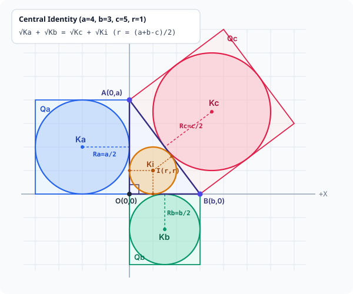

# Four-Circles Pythagorean Geometry Lab

*Interactive Parametric Exploration of the Pythagorean Theorem Through Four Circles.*

[Русская версия (`README_RU.md`)](README_RU.md) · [Mathematical Foundation](docs/MATHEMATICAL_FOUNDATION.md) · [Formula Passports (UMFP)](docs/FORMULA_PASSPORTS.md) · [Dependency Graph](docs/FORMULA_DEPENDENCY_GRAPH.md) · [Mathematical Proofs](docs/MATHEMATICAL_PROOFS.md) · [Architecture](docs/ARCHITECTURE.md) · [User Guide](docs/USER_GUIDE.md) · [Verification & Testing](docs/VERIFICATION_AND_TESTING.md) · [Release Readiness](docs/RELEASE_READINESS.md)

---

## 1. Overview

**Four-Circles Pythagorean Geometry Lab** (referred to in the UI as **Pythagoras — Four Circles Laboratory**) is an interactive React, TypeScript, and Vite mathematical research workspace for investigating the geometric and algebraic relationships connecting:

- A right triangle $OAB$ with legs $a, b > 0$ and hypotenuse $c = \sqrt{a^2 + b^2}$,
- Three exterior squares constructed on its sides ($Q_a, Q_b, Q_c$),
- Three circles inscribed in those squares ($K_a, K_b, K_c$), and
- A fourth circle ($K_i$) inscribed directly inside the right triangle.

Every geometric parameter, SVG overlay, invariant check, and parametric curve is derived deterministically from a single shared state $(a, b)$.

---

## 2. Main Mathematical Idea

While the Pythagorean theorem equates the areas of squares on the sides ($a^2 + b^2 = c^2$) — and consequently equates the areas of the three square-inscribed circles ($K_a + K_b = K_c$) — introducing the triangle's own incircle $K_i$ reveals a **derived linear-scale identity** in the square roots of all four circle areas (holding for all Euclidean right triangles with $a, b > 0$):

$$\sqrt{K_a} + \sqrt{K_b} = \sqrt{K_c} + \sqrt{K_i}$$

The laboratory contrasts this exact derived identity against the direct area sum, demonstrating geometrically and numerically why $K_a + K_b \neq K_c + K_i$ (specifically, $K_a + K_b - K_c - K_i = -K_i < 0$).

---

## 3. Geometric Interpretation of the Four Circles



In the standard orthonormal Cartesian coordinate system with right angle at $O(0,0)$, $A(0, a)$, and $B(b, 0)$:

| Circle | Geometric Construction | Center | Diameter $D$ | Radius $R$ | Area $K$ |
|---|---|---|---|---|---|
| **$K_a$** | Inscribed in exterior square $Q_a$ on leg $OA$ | $\left(-\frac{a}{2},\; \frac{a}{2}\right)$ | $a$ | $\frac{a}{2}$ | $\frac{\pi a^2}{4}$ |
| **$K_b$** | Inscribed in exterior square $Q_b$ on leg $OB$ | $\left(\frac{b}{2},\; -\frac{b}{2}\right)$ | $b$ | $\frac{b}{2}$ | $\frac{\pi b^2}{4}$ |
| **$K_c$** | Inscribed in exterior square $Q_c$ on hypotenuse $AB$ | $\left(\frac{a+b}{2},\; \frac{a+b}{2}\right)$ | $c$ | $\frac{c}{2}$ | $\frac{\pi c^2}{4}$ |
| **$K_i$** | Incircle inside right triangle $\triangle OAB$ | $(r,\; r)$ | $2r$ | $r = \frac{a + b - c}{2}$ | $\pi r^2$ |

---

## 4. Central Mathematical Identity

Taking the principal square root of each circle area converts quadratic area units into linear diameter/radius scales proportional to $\sqrt{\pi}$:

$$\sqrt{K_a} = \frac{\sqrt{\pi}}{2}a, \qquad \sqrt{K_b} = \frac{\sqrt{\pi}}{2}b, \qquad \sqrt{K_c} = \frac{\sqrt{\pi}}{2}c, \qquad \sqrt{K_i} = \sqrt{\pi}\,r = \frac{\sqrt{\pi}}{2}(a + b - c)$$

Adding the hypotenuse and incircle terms yields:

$$\sqrt{K_c} + \sqrt{K_i} = \frac{\sqrt{\pi}}{2}c + \frac{\sqrt{\pi}}{2}(a + b - c) = \frac{\sqrt{\pi}}{2}(a + b) = \sqrt{K_a} + \sqrt{K_b}$$

Full step-by-step derivations, UMFP formula passports (`PCL-A01`–`PCL-F24`), and numerical stability proofs are documented in [`docs/MATHEMATICAL_FOUNDATION.md`](docs/MATHEMATICAL_FOUNDATION.md), [`docs/FORMULA_PASSPORTS.md`](docs/FORMULA_PASSPORTS.md), and [`docs/MATHEMATICAL_PROOFS.md`](docs/MATHEMATICAL_PROOFS.md).

---

## 5. Key Application Features

- **Interactive SVG Geometry Board (`GeometryBoard.tsx`):** Drag vertices $A(0,a)$ vertically or $B(b,0)$ horizontally, pan and zoom the coordinate canvas, toggle grid, labels, centers, radii, and angle arcs, and filter visibility layers (`all`, `triangle_incircle`, `squares`, `square_circles`).
- **Four Analytical Workspace Views:**
  1. `01. Four Circles` — Unified view of $\triangle OAB$, $Q_a, Q_b, Q_c$, and $K_a, K_b, K_c, K_i$.
  2. `02. √K Identity` — Algebraic proof context and real-time LHS vs. RHS residual observer.
  3. `03. Incircle Kᵢ` — Focused view of $\triangle OAB$ and $K_i$ with tangency points $T_a, T_b, T_c$.
  4. `04. Spectral Analysis` — Interactive parametric function plotting over $t = b/a$.
- **Live 8-Invariant Verification (`InvariantsPanel.tsx` & `TestRunnerModal.tsx`):** Scale-normalized validation of inradius positivity, square orthogonality, tangency of all four circles, area formulas, central $\sqrt{K}$ identity, Pythagorean area sum, and area contrast at tolerance $10^{-9}$.
- **Experiment Controls & Exports:** Preset control triangles `(3,4,5)`, `(5,12,13)`, `(4,4,4√2)`, `(1,10,√101)`, `(10,1,√101)`, `(8,15,17)`; continuous leg sweep; Undo/Redo history; side-by-side comparison modal; JSON configuration save/load (`localStorage` + file export/import); PNG/SVG board export; step-by-step construction animation; `RU/UK/EN` switcher covering top navigation, bottom toolbar, board controls, and summary headers *(detailed analytical panel copy and modals are currently primarily in Russian; see [`docs/PROJECT_STATUS.md`](docs/PROJECT_STATUS.md))*.

---

## 5.1 Mathematical Documentation & UMFP Methodology

All 24 core formulas, geometric constructions, invariant guards, and parametric relations are documented in [`docs/FORMULA_PASSPORTS.md`](docs/FORMULA_PASSPORTS.md) (`PCL-A01`–`PCL-F24`), [`docs/FORMULA_DEPENDENCY_GRAPH.md`](docs/FORMULA_DEPENDENCY_GRAPH.md), [`docs/MATHEMATICAL_PROOFS.md`](docs/MATHEMATICAL_PROOFS.md), [`docs/NUMERICAL_ANALYSIS.md`](docs/NUMERICAL_ANALYSIS.md), and [`docs/VERIFICATION_MATRIX.md`](docs/VERIFICATION_MATRIX.md).

- **Methodological Alignment (UMFP):** The passport registry adopts the **Universal Mathematical Formula Passport (UMFP)** schema (`RAW` vs. `NORMALIZED` representations, structural classification, variable scopes, domain constraints, diagnostic notes, and separated epistemic statuses `VERIFIED`, `DERIVED`, `CONJECTURE`, `ANALOGY`).
- **Scope Honesty:** This project uses UMFP **strictly as a methodological documentation standard** — it does **not** import or execute runtime code (`FormulaPassport`, `generatePassport()`, `comparePassports()`, `compareExpressions()`, `Insight Bank`) from the external UMFP engine repository.

---

## 6. Interactive Parametric Analysis

> **Terminology Note:** Module 04 is labeled **"04. Спектральный анализ" (`spectral_analysis`)** in the interface. In the current codebase, it performs **parametric graphical ratio analysis** as a function of the dimensionless leg ratio $t = b/a$ (normalized relative to $K_c$), rather than Fourier/DFT frequency-domain decomposition.

Using the normalized triangle $a = 1,\; b = t,\; c(t) = \sqrt{1+t^2},\; r(t) = \frac{1+t-\sqrt{1+t^2}}{2}$ computed directly via `calculateFourCircles(1, t)`:

- **Mode A — Areas:** $K_a(t)/K_c(t)$, $K_b(t)/K_c(t)$, $K_c(t)/K_c(t) = 1$, $K_i(t)/K_c(t)$
- **Mode B — Perimeters ($P = 2\pi R = \pi D$):** $P_a(t)/P_c(t)$, $P_b(t)/P_c(t)$, $P_c(t)/P_c(t) = 1$, $P_i(t)/P_c(t)$
- **Mode C — Radii & Diameters:** $R_x(t)/R_c(t)$ and $D_x(t)/D_c(t)$ with a `Radius | Diameter` switch (the normalized curves coincide because $D = 2R$)

**Interactive Capabilities:**
- Click or drag directly on the SVG Cartesian plot (`viewBox="0 0 640 300"`) to scrub $t$ and synchronously update the triangle $(a, b)$, four circles, and numerical table.
- Toggle between **Logarithmic ($\log_{10} t$)** (default, centering the symmetry axis $t = 1$) and **Linear ($t$)** horizontal axes.
- Zoom in/out, reset to $[0.1, 10]$, jump to reference ratios (`t = 0.1, 0.5, 1.0, 2.0, 10.0`), or animate smoothly through the symmetry point $t = 1$.

---

## 7. Architecture Overview

The codebase separates pure mathematical logic (`src/math/`), coordinate transforms (`src/geometry/`), reactive UI state (`src/App.tsx`), and presentation components (`src/components/`):

- `src/math/FourCirclesModel.ts` — Core parametric calculation engine (`calculateFourCircles(a, b)`).
- `src/math/FourCirclesSpectralAnalysis.ts` — Parametric curve evaluation (`evaluateParametricFourCircles`, `sampleSpectralCurves`), ratio-to-leg mapping (`legsFromRatioAndHypotenuse`), and current-state breakdowns.
- `src/math/FourCirclesValidators.ts` — Scale-normalized validation of 8 geometric/algebraic invariants.
- `src/App.tsx` — Single authoritative `(a, b)` state, Undo/Redo history, `handleChangeT` synchronization, and PNG/SVG export.

See [`docs/ARCHITECTURE.md`](docs/ARCHITECTURE.md) for the full module map and Mermaid data-flow diagram.

---

## 8. Technology Stack

- **Frontend:** React 19 (`^19.0.1`), TypeScript (`^7.0.2`), Vite 8 (`^8.3.0`)
- **Styling & Icons:** Tailwind CSS v4 (`@tailwindcss/vite`), `lucide-react`
- **Mathematical Rendering:** `katex` (via `MathFormula.tsx` and CDN stylesheet in `index.html`)
- **Testing & Verification:** Node `assert/strict` executed via `tsx` (`src/tests/geometry.test.ts`), TypeScript compiler (`tsc --noEmit`)

---

## 9. Installation

**Prerequisites:** Node.js (v18+ recommended) and `npm`.

```bash
git clone <repository-url>
cd Four-Circles-Pythagorean-Lab
npm install
```

---

## 10. Development

Start the Vite development server on port `3000`:

```bash
npm run dev
```

Then open `http://localhost:3000` in your browser.

---

## 11. Build and Test

All commands match `package.json`:

```bash
# Run the mathematical & synchronization unit test suite
npm test

# Run TypeScript static type validation
npm run lint

# Build the production bundle into dist/
npm run build

# Preview the production build locally
npm run preview
```

See [`docs/VERIFICATION_AND_TESTING.md`](docs/VERIFICATION_AND_TESTING.md) for test coverage details.

---

## 12. Project Structure

```text
.
├── docs/                                # Mathematical & architectural documentation
│   ├── assets/four-circles-diagram.svg  # Geometric model schematic (4,3,5)
│   ├── ARCHITECTURE.md                  # Software architecture & data-flow diagram
│   ├── FORMULA_DEPENDENCY_GRAPH.md      # UMFP formula dependency DAG (PCL-A01..F24)
│   ├── FORMULA_PASSPORTS.md             # UMFP formula passports (PCL-A01..F24)
│   ├── MATHEMATICAL_FOUNDATION.md       # Complete mathematical & parametric foundation
│   ├── MATHEMATICAL_PROOFS.md           # Step-by-step formal proofs
│   ├── NUMERICAL_ANALYSIS.md            # IEEE-754 float64 precision & stability analysis
│   ├── PROJECT_STATUS.md                # Verified current status & repository notes
│   ├── RELEASE_READINESS.md             # Pre-publication verification & status report
│   ├── ROADMAP.md                       # Proposed future enhancements
│   ├── USER_GUIDE.md                    # Practical usage guide
│   ├── VERIFICATION_AND_TESTING.md      # Test suite & verification guide
│   └── VERIFICATION_MATRIX.md           # Formula-to-test traceability matrix
├── src/
│   ├── components/
│   │   ├── common/                      # BottomToolbar, Header, MathFormula, MetricCard
│   │   ├── geometry/                    # CoordinateGrid, FourCirclesView, GeometryBoard,
│   │   │                                # InteractivePoint, RightTriangleView
│   │   └── panels/                      # ComparisonModal, ControlsPanel, FourCirclesPanel,
│   │                                    # HelpModal, InvariantsPanel, SpectralAnalysisPanel,
│   │                                    # TestRunnerModal
│   ├── geometry/transforms.ts           # Cartesian <-> SVG screen coordinate mapping
│   ├── i18n/translations.ts             # RU / UK / EN translation dictionary
│   ├── math/
│   │   ├── FourCirclesModel.ts          # Authoritative 4-circle geometry calculation
│   │   ├── FourCirclesSpectralAnalysis.ts # Parametric ratio curves & t -> (a, b) sync
│   │   ├── FourCirclesValidators.ts     # 8 scale-normalized invariant validators
│   │   ├── RightTriangle.ts             # Right triangle geometry
│   │   ├── SquareConstruction.ts        # Exterior squares Qa, Qb, Qc
│   │   ├── inputValidation.ts           # Strict positive finite leg assertions
│   │   └── presets.ts                   # Control triangle presets
│   ├── tests/geometry.test.ts           # Automated verification suite
│   ├── types/geometry.ts                # Core TypeScript interfaces
│   ├── App.tsx                          # Application root & state orchestration
│   ├── index.css                        # Tailwind CSS v4 entry
│   └── main.tsx                         # React DOM entry point
├── index.html                           # HTML entry with fonts & KaTeX CSS
├── LICENSE                              # MIT License
├── package.json                         # Project metadata, scripts & dependencies
├── tsconfig.json                        # TypeScript configuration
└── vite.config.ts                       # Vite 8 build & dev server config
```

---

## 13. Mathematical Limitations & Numerical Precision Notes

1. **Non-degeneracy domain:** All formulas assume a non-degenerate right triangle ($a, b > 0$, finite). `inputValidation.ts` throws `InvalidTriangleInputError` on `<= 0`, `NaN`, or `±Infinity`.
2. **Interactive UI bounds:** While `FourCirclesModel.ts` supports arbitrary finite $a, b > 0$ (verified in tests from $10^{-6}$ up to $10^{50}$), `App.tsx` clamps interactive legs to $a, b \in [0.2, 15]$ (sliders in `ControlsPanel.tsx` span $[0.5, 12]$).
3. **Floating-point arithmetic (`float64`):**
   - Hypotenuse uses `Math.hypot(a, b)` to avoid intermediate overflow/underflow.
   - Inradius uses $r = \frac{a}{a+b+c} \cdot b$ (algebraically equal to $\frac{a+b-c}{2}$) to prevent catastrophic cancellation when $a \ll b$ or $b \ll a$.
   - Areas scale quadratically, so IEEE-754 `float64` underflows around $10^{-162}$ and overflows above $\sim 10^{154}$ (verified in [`docs/NUMERICAL_ANALYSIS.md`](docs/NUMERICAL_ANALYSIS.md)).

---

## 14. License

This project is distributed under the **MIT License** — see [`LICENSE`](LICENSE) for full terms.

The MIT License permits commercial use, modification, distribution, private use, creation of derivative works, and redistribution of modified versions, subject to preserving the copyright notice and license text.

---

## 15. Author Attribution

**Copyright (c) 2026 Andrey Artsybashev**

*Note:* This copyright notice and attribution apply solely to the original software, architecture, implementation, interactive visualizations, and documentation in this repository. They do not claim ownership over classical Euclidean geometry, the Pythagorean theorem, established formulas, or general mathematical knowledge.

See [`docs/PROJECT_STATUS.md`](docs/PROJECT_STATUS.md) and [`docs/RELEASE_READINESS.md`](docs/RELEASE_READINESS.md) for current project status, known UI localization limits, and verification scope.
