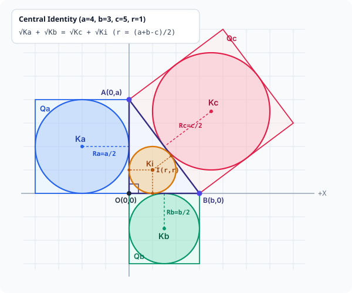

# Four-Circles Pythagorean Geometry Lab (`Pythagoras-Circles-Lab`)

*Интерактивное исследование теоремы Пифагора через четыре круга, геометрические зависимости и параметрическую визуализацию.*

[English Version (`README.md`)](README.md) · [Математическое основание](docs/MATHEMATICAL_FOUNDATION.md) · [Паспорта формул (UMFP)](docs/FORMULA_PASSPORTS.md) · [Граф зависимостей](docs/FORMULA_DEPENDENCY_GRAPH.md) · [Доказательства](docs/MATHEMATICAL_PROOFS.md) · [Архитектура](docs/ARCHITECTURE.md) · [Руководство пользователя](docs/USER_GUIDE.md) · [Верификация и тестирование](docs/VERIFICATION_AND_TESTING.md) · [Готовность к релизу](docs/RELEASE_READINESS.md)

---

## 1. Описание проекта

**Four-Circles Pythagorean Geometry Lab** (в интерфейсе приложения — **Pythagoras — Four Circles Laboratory**) — интерактивный математический исследовательский стенд на базе React, TypeScript и Vite, посвящённый изучению геометрических и алгебраических соотношений, объединяющих:

- прямоугольный треугольник $OAB$ с катетами $a, b > 0$ и гипотенузой $c = \sqrt{a^2 + b^2}$,
- три внешних квадрата на его сторонах ($Q_a, Q_b, Q_c$),
- три окружности, вписанные в эти квадраты ($K_a, K_b, K_c$), и
- четвёртую окружность ($K_i$), вписанную непосредственно внутрь прямоугольного треугольника.

Все геометрические построения, слои SVG-сцены, проверки инвариантов и кривые параметрических графиков детерминированно рассчитываются из единого разделяемого состояния $(a, b)$.

---

## 2. Основная математическая идея

Теорема Пифагора связывает площади квадратов на сторонах треугольника ($a^2 + b^2 = c^2$), а значит, и площади вписанных в них кругов ($K_a + K_b = K_c$). Если добавить к этой конструкции вписанную окружность треугольника $K_i$, возникает **выведенное линейно-масштабное тождество** для квадратных корней из площадей всех четырёх кругов (выполняется для всех евклидовых прямоугольных треугольников с $a, b > 0$):

$$\sqrt{K_a} + \sqrt{K_b} = \sqrt{K_c} + \sqrt{K_i}$$

Стенд наглядно противопоставляет это точное выведенное тождество прямой сумме площадей, показывая геометрически и численно, почему $K_a + K_b \neq K_c + K_i$ (а именно $K_a + K_b - K_c - K_i = -K_i < 0$).

---

## 3. Геометрическая интерпретация четырёх кругов



В стандартной ортонормированной декартовой системе координат с прямым углом в $O(0,0)$, $A(0, a)$ и $B(b, 0)$:

| Круг | Геометрическое построение | Центр | Диаметр $D$ | Радиус $R$ | Площадь $K$ |
|---|---|---|---|---|---|
| **$K_a$** | Вписан во внешний квадрат $Q_a$ на катете $OA$ | $\left(-\frac{a}{2},\; \frac{a}{2}\right)$ | $a$ | $\frac{a}{2}$ | $\frac{\pi a^2}{4}$ |
| **$K_b$** | Вписан во внешний квадрат $Q_b$ на катете $OB$ | $\left(\frac{b}{2},\; -\frac{b}{2}\right)$ | $b$ | $\frac{b}{2}$ | $\frac{\pi b^2}{4}$ |
| **$K_c$** | Вписан во внешний квадрат $Q_c$ на гипотенузе $AB$ | $\left(\frac{a+b}{2},\; \frac{a+b}{2}\right)$ | $c$ | $\frac{c}{2}$ | $\frac{\pi c^2}{4}$ |
| **$K_i$** | Обычная вписанная окружность (инциркл) $\triangle OAB$ | $(r,\; r)$ | $2r$ | $r = \frac{a + b - c}{2}$ | $\pi r^2$ |

---

## 4. Центральное математическое тождество

Извлечение арифметического квадратного корня из площади каждого круга переводит квадратичные единицы площади в линейные масштабы диаметров и радиусов с множителем $\sqrt{\pi}$:

$$\sqrt{K_a} = \frac{\sqrt{\pi}}{2}a, \qquad \sqrt{K_b} = \frac{\sqrt{\pi}}{2}b, \qquad \sqrt{K_c} = \frac{\sqrt{\pi}}{2}c, \qquad \sqrt{K_i} = \sqrt{\pi}\,r = \frac{\sqrt{\pi}}{2}(a + b - c)$$

Сложение величин для гипотенузного и вписанного кругов даёт:

$$\sqrt{K_c} + \sqrt{K_i} = \frac{\sqrt{\pi}}{2}c + \frac{\sqrt{\pi}}{2}(a + b - c) = \frac{\sqrt{\pi}}{2}(a + b) = \sqrt{K_a} + \sqrt{K_b}$$

Подробные пошаговые выводы, паспорта формул UMFP (`PCL-A01`–`PCL-F24`) и проверка численной устойчивости приведены в [`docs/MATHEMATICAL_FOUNDATION.md`](docs/MATHEMATICAL_FOUNDATION.md), [`docs/FORMULA_PASSPORTS.md`](docs/FORMULA_PASSPORTS.md) и [`docs/MATHEMATICAL_PROOFS.md`](docs/MATHEMATICAL_PROOFS.md).

---

## 5. Ключевые возможности приложения

- **Интерактивная SVG-сцена (`GeometryBoard.tsx`):** перетаскивание вершин $A(0,a)$ по вертикали и $B(b,0)$ по горизонтали, панорамирование и зум, переключение сетки, подписей, центров, радиусов и углов, фильтрация слоёв (`Все`, `△ и Kᵢ`, `Квадраты Q`, `Круги K_a,b,c`).
- **Четыре аналитических модуля:**
  1. `01. Четыре круга` — единая визуализация $\triangle OAB$, $Q_a, Q_b, Q_c$ и $K_a, K_b, K_c, K_i$.
  2. `02. Тождество √K` — алгебраическое доказательство и мониторинг невязки левой и правой частей.
  3. `03. Вписанный круг Kᵢ` — фокус на инциркле $\triangle OAB$, точках касания $T_a, T_b, T_c$ и радиусе $r$.
  4. `04. Спектральный анализ` — интерактивный декартовый график параметрических функций от $t = b/a$.
- **Проверка 8 инвариантов в реальном времени (`InvariantsPanel.tsx` и `TestRunnerModal.tsx`):** масштабно-инвариантная валидация положительности $r$, ортогональности квадратов, касания всех четырёх окружностей, формул площадей, тождества корней $\sqrt{K}$, пифагоровой суммы $K_a + K_b = K_c$ и контраста $-K_i$ с допуском $10^{-9}$.
- **Инструменты исследования и экспорта:** пресеты контрольных треугольников `(3,4,5)`, `(5,12,13)`, `(4,4,4√2)`, `(1,10,√101)`, `(10,1,√101)`, `(8,15,17)`; плавная анимация катетов; Undo/Redo; модальное сравнение конфигураций; сохранение/загрузка JSON (`localStorage` и файлы); экспорт PNG/SVG; пошаговая анимация построения; полная **локализация `RU / UK / EN`** верхнего меню, нижней панели (включая окно загрузки/сохранения), всплывающих подсказок SVG-сцены, панели управления, всех аналитических модулей, инвариантов и модальных окон (с синхронизацией атрибута `<html lang>`).

---

## 5.1 Математическая документация и стандарт UMFP

Все 24 базовые формулы, геометрические построения, инварианты и параметрические зависимости описаны в [`docs/FORMULA_PASSPORTS.md`](docs/FORMULA_PASSPORTS.md) (`PCL-A01`–`PCL-F24`), [`docs/FORMULA_DEPENDENCY_GRAPH.md`](docs/FORMULA_DEPENDENCY_GRAPH.md), [`docs/MATHEMATICAL_PROOFS.md`](docs/MATHEMATICAL_PROOFS.md), [`docs/NUMERICAL_ANALYSIS.md`](docs/NUMERICAL_ANALYSIS.md) и [`docs/VERIFICATION_MATRIX.md`](docs/VERIFICATION_MATRIX.md).

- **Методологическое соответствие UMFP:** паспорта оформлены по концептуальной модели **Universal Mathematical Formula Passport (UMFP)** (`RAW` и `NORMALIZED` представление, структурная классификация, области действия переменных, ограничения области определения, диагностика и разделение статусов `VERIFIED`, `DERIVED`, `CONJECTURE`, `ANALOGY`).
- **Честный статус интеграции:** UMFP применяется в этом репозитории **исключительно как методологический стандарт документации** — внешние программные модули (`FormulaPassport`, `generatePassport()`, `comparePassports()`, `compareExpressions()`, `Insight Bank`) в коде приложения не подключаются и не вызываются.

---

## 6. Интерактивный параметрический анализ

> **Примечание к терминологии:** В интерфейсе вкладка называется **«04. Спектральный анализ» (`spectral_analysis`)**. В текущей кодовой базе она выполняет **параметрический графический анализ** отношений величин в зависимости от безразмерного параметра $t = b/a$ (нормировка на круг $K_c$), а не гармонический/Фурье-анализ (DFT/FFT).

При нормировке $a = 1,\; b = t,\; c(t) = \sqrt{1+t^2},\; r(t) = \frac{1+t-\sqrt{1+t^2}}{2}$ значения рассчитываются непосредственно через `calculateFourCircles(1, t)`:

- **Режим A — Площади:** $K_a(t)/K_c(t)$, $K_b(t)/K_c(t)$, $K_c(t)/K_c(t) = 1$, $K_i(t)/K_c(t)$
- **Режим B — Периметры ($P = 2\pi R = \pi D$):** $P_a(t)/P_c(t)$, $P_b(t)/P_c(t)$, $P_c(t)/P_c(t) = 1$, $P_i(t)/P_c(t)$
- **Режим C — Радиусы и диаметры:** $R_x(t)/R_c(t)$ и $D_x(t)/D_c(t)$ с переключателем `Радиусы (R)` / `Диаметры (D)` (нормированные кривые совпадают, так как $D = 2R$)

**Возможности взаимодействия:**
- Клик и перетаскивание непосредственно по декартовому SVG-графику (`viewBox="0 0 640 300"`) изменяют $t$ и синхронно перестраивают треугольник $(a, b)$, четыре круга и таблицу значений.
- Переключение между **логарифмической ($\log_{10} t$)** (по умолчанию — ось симметрии $t = 1$ расположена в центре) и **линейной ($t$)** горизонтальной шкалой.
- Масштабирование (`Zoom +`/`-`), сброс диапазона к `[0.1, 10]`, быстрый переход к эталонным точкам (`t = 0.1, 0.5, 1.0, 2.0, 10.0`) и плавный проход через точку симметрии $t = 1$.

---

## 7. Обзор архитектуры

Кодовая база строго разделяет чистую математику (`src/math/`), координатные преобразования (`src/geometry/`), корневое состояние (`src/App.tsx`) и UI-компоненты (`src/components/`):

- `src/math/FourCirclesModel.ts` — детерминированное ядро расчёта (`calculateFourCircles(a, b)`).
- `src/math/FourCirclesSpectralAnalysis.ts` — расчёт параметрических кривых (`evaluateParametricFourCircles`, `sampleSpectralCurves`), преобразование $t \to (a, b)$ (`legsFromRatioAndHypotenuse`) и текущий срез метрик.
- `src/math/FourCirclesValidators.ts` — валидатор 8 геометрических и алгебраических инвариантов.
- `src/App.tsx` — единое состояние `(a, b)`, стек Undo/Redo, синхронизация `handleChangeT` и экспорт PNG/SVG.

Подробное описание и диаграмма потоков данных приведены в [`docs/ARCHITECTURE.md`](docs/ARCHITECTURE.md).

---

## 8. Технологический стек

- **Frontend:** React 19 (`^19.0.1`), TypeScript (`^7.0.2`), Vite 8 (`^8.3.0`)
- **Стили и иконки:** Tailwind CSS v4 (`@tailwindcss/vite`), `lucide-react`
- **Отрисовка формул:** `katex` (компонент `MathFormula.tsx` с локальным импортом `katex/dist/katex.min.css` и шрифтов `.woff2`/`.woff`/`.ttf` в сборке Vite; без внешней зависимости от KaTeX CDN)
- **Тестирование и проверки:** Node `assert/strict` через `tsx` (`src/tests/geometry.test.ts`), компилятор TypeScript (`tsc --noEmit`)

---

## 9. Установка

**Требования:** Node.js (рекомендуется v18+) и `bun` (основной lockfile: `bun.lock`) или `npm`.

```bash
git clone https://github.com/a50kv109/Pythagoras-Circles-Lab.git
cd Pythagoras-Circles-Lab
bun install --frozen-lockfile   # или: npm install
```

---

## 10. Запуск в режиме разработки

Запуск Vite dev-сервера на порту `3000`:

```bash
npm run dev
```

После запуска откройте `http://localhost:3000` в браузере.

---

## 11. Сборка и тестирование

Все команды соответствуют `package.json`:

```bash
# Запуск модульных тестов математического ядра, графика и синхронизации
npm test

# Проверка типов TypeScript
npm run lint

# Сборка production-версии в каталог dist/
npm run build

# Локальный предпросмотр собранного приложения
npm run preview
```

Подробности тестового покрытия см. в [`docs/VERIFICATION_AND_TESTING.md`](docs/VERIFICATION_AND_TESTING.md).

---

## 12. Структура проекта

```text
.
├── docs/                                # Математическая и архитектурная документация
│   ├── assets/four-circles-diagram.svg  # Векторная схема модели (4,3,5)
│   ├── ARCHITECTURE.md                  # Архитектура ПО и схема потоков данных
│   ├── FORMULA_DEPENDENCY_GRAPH.md      # Граф зависимостей формул UMFP (PCL-A01..F24)
│   ├── FORMULA_PASSPORTS.md             # Паспорта формул UMFP (PCL-A01..F24)
│   ├── MATHEMATICAL_FOUNDATION.md       # Математическое и параметрическое основание
│   ├── MATHEMATICAL_PROOFS.md           # Пошаговые доказательства
│   ├── NUMERICAL_ANALYSIS.md            # Анализ точности в IEEE-754 float64
│   ├── PROJECT_STATUS.md                # Верифицированный статус проекта
│   ├── RELEASE_READINESS.md             # Отчёт о готовности к публикации на GitHub
│   ├── ROADMAP.md                       # Предлагаемый план развития
│   ├── USER_GUIDE.md                    # Руководство пользователя
│   ├── VERIFICATION_AND_TESTING.md      # Документация по тестам и проверкам
│   └── VERIFICATION_MATRIX.md           # Матрица соответствия формул и тестов
├── src/
│   ├── components/
│   │   ├── common/                      # BottomToolbar, Header, MathFormula, MetricCard
│   │   ├── geometry/                    # CoordinateGrid, FourCirclesView, GeometryBoard,
│   │   │                                # InteractivePoint, RightTriangleView
│   │   └── panels/                      # ComparisonModal, ControlsPanel, FourCirclesPanel,
│   │                                    # HelpModal, InvariantsPanel, SpectralAnalysisPanel,
│   │                                    # TestRunnerModal
│   ├── geometry/transforms.ts           # Преобразования декартовы <-> экранные координаты SVG
│   ├── i18n/translations.ts             # Словари интерфейса (RU / UK / EN)
│   ├── math/
│   │   ├── FourCirclesModel.ts          # Вычислительное ядро 4 кругов
│   │   ├── FourCirclesSpectralAnalysis.ts # Параметрические кривые и синхронизация t -> (a, b)
│   │   ├── FourCirclesValidators.ts     # Валидатор 8 инвариантов
│   │   ├── RightTriangle.ts             # Геометрия прямоугольного треугольника
│   │   ├── SquareConstruction.ts        # Внешние квадраты Qa, Qb, Qc
│   │   ├── inputValidation.ts           # Контракт проверки катетов
│   │   └── presets.ts                   # Пресеты контрольных треугольников
│   ├── tests/geometry.test.ts           # Автоматический набор тестов
│   ├── types/geometry.ts                # Типы и интерфейсы TypeScript
│   ├── App.tsx                          # Корневой компонент и единое состояние
│   ├── index.css                        # Точка входа Tailwind CSS v4
│   └── main.tsx                         # Точка входа React DOM
├── bun.lock                             # Основной lockfile (Bun)
├── index.html                           # HTML-точка входа (KaTeX собирается локально через Vite)
├── LICENSE                              # Лицензия MIT
├── metadata.json                        # Метаданные дескриптора приложения
├── package.json                         # Метаданные, скрипты и зависимости
├── tsconfig.json                        # Конфигурация TypeScript
└── vite.config.ts                       # Конфигурация Vite 8
```

---

## 13. Математические ограничения и численная точность

1. **Область допустимых значений:** все формулы определены для невырожденного прямоугольного треугольника ($a, b > 0$, конечные числа). Модуль `inputValidation.ts` выбрасывает `InvalidTriangleInputError` при `<= 0`, `NaN` или `±Infinity`.
2. **Ограничения интерактивного UI:** ядро `FourCirclesModel.ts` допускает любые конечные положительные $a, b > 0$ (в тестах проверено от $10^{-6}$ до $10^{50}$), тогда как `App.tsx` ограничивает интерактивное изменение катетов диапазоном $a, b \in [0.2, 15]$ (ползунки `ControlsPanel.tsx` — $[0.5, 12]$).
3. **Арифметика `float64`:**
   - Гипотенуза вычисляется через `Math.hypot(a, b)` во избежание промежуточного переполнения/исчезновения порядка.
   - Вписанный радиус вычисляется через $r = \frac{a}{a+b+c}\cdot b$ (алгебраически эквивалентно $\frac{a+b-c}{2}$), что устраняет катастрофическое сокращение значащих цифр при сильной асимметрии ($a \ll b$ или $b \ll a$).
   - Площади масштабируются квадратично, поэтому в `float64` underflow наступает около $10^{-162}$, а overflow — выше $\sim 10^{154}$ (см. [`docs/NUMERICAL_ANALYSIS.md`](docs/NUMERICAL_ANALYSIS.md)).

---

## 14. Лицензия

Проект распространяется под лицензией **MIT License** — полный текст приведён в файле [`LICENSE`](LICENSE).

Лицензия MIT разрешает коммерческое использование, модификацию, распространение, частное использование, создание производных произведений и распространение изменённых версий при условии сохранения уведомления об авторских правах и текста лицензии.

---

## 15. Авторство

**Copyright (c) 2026 Andrey Artsybashev**

*Примечание:* указанное авторское право относится исключительно к оригинальному программному обеспечению, архитектуре проекта, реализации, интерактивным визуализациям и документации в данном репозитории и не претендует на авторство классических математических теорем, формул или общеизвестных математических знаний.

Текущий статус проекта, границы тестирования и готовность к релизу подробно отражены в [`docs/PROJECT_STATUS.md`](docs/PROJECT_STATUS.md) и [`docs/RELEASE_READINESS.md`](docs/RELEASE_READINESS.md).
